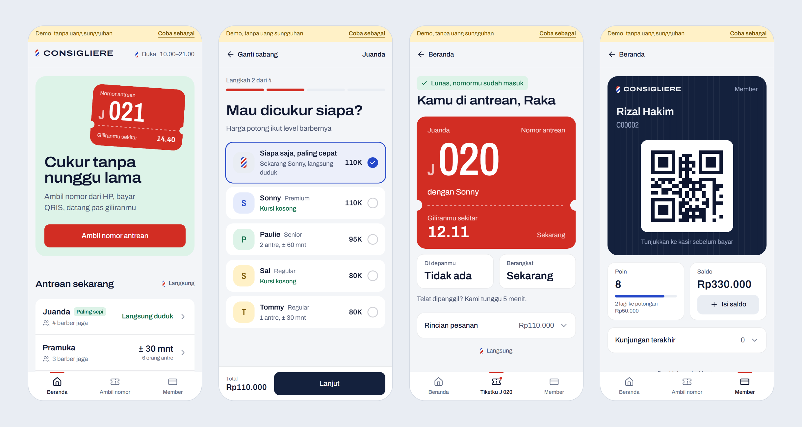
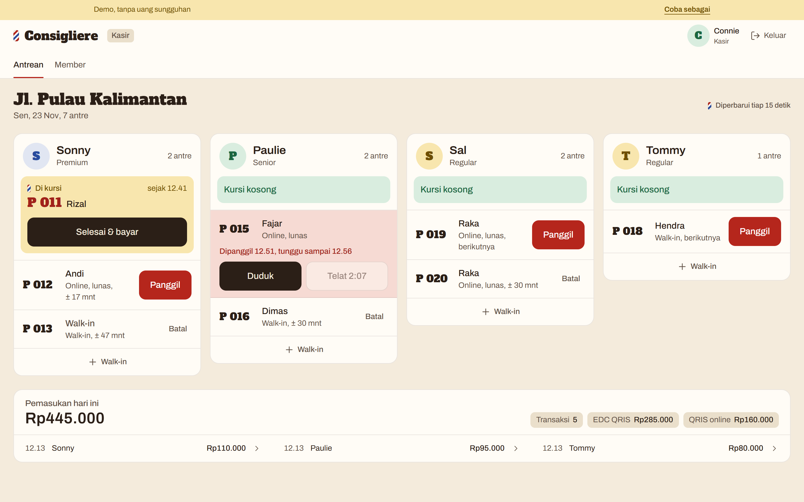
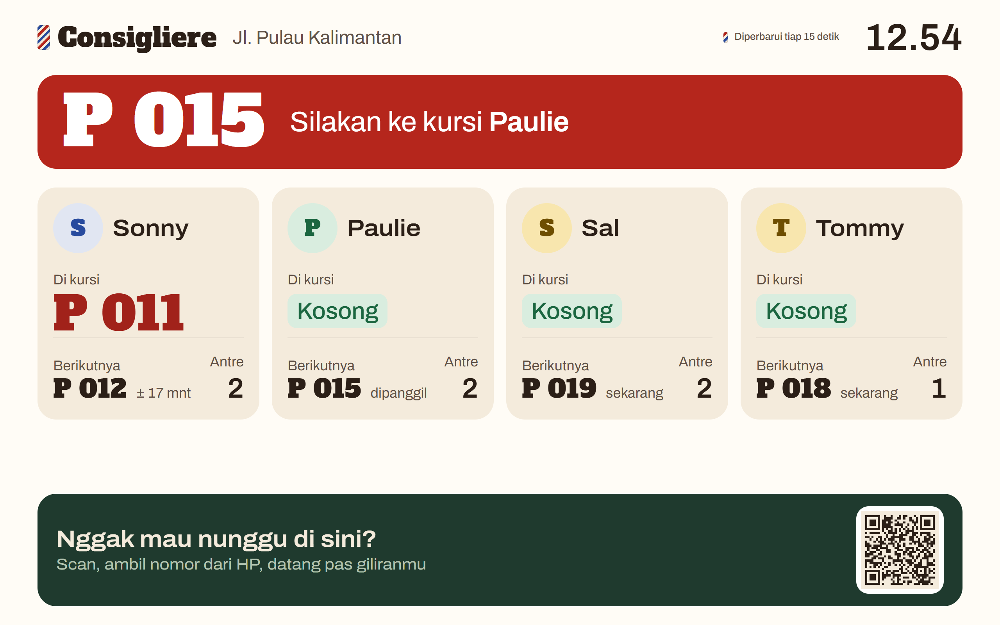
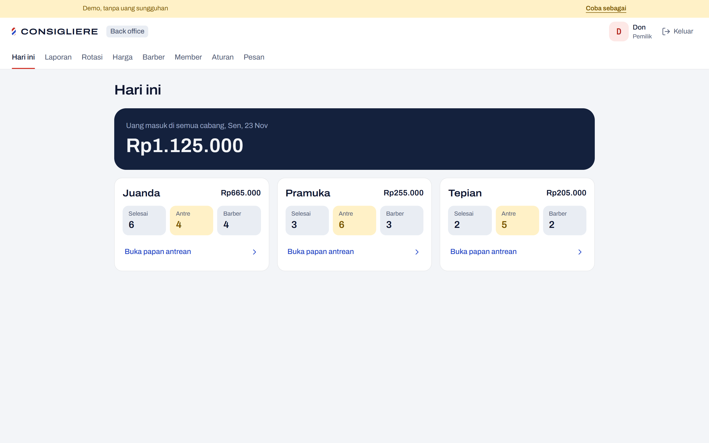
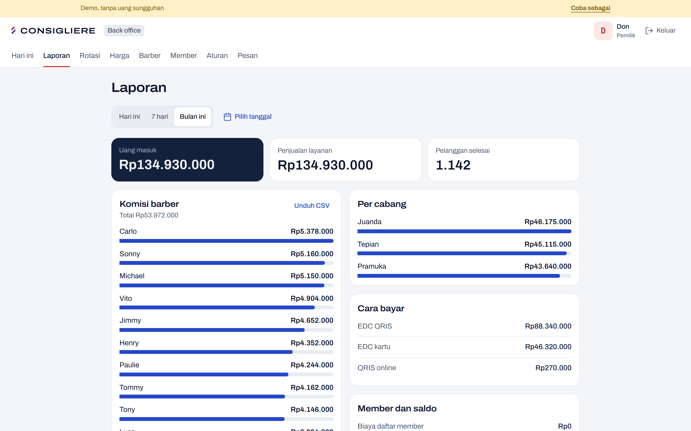
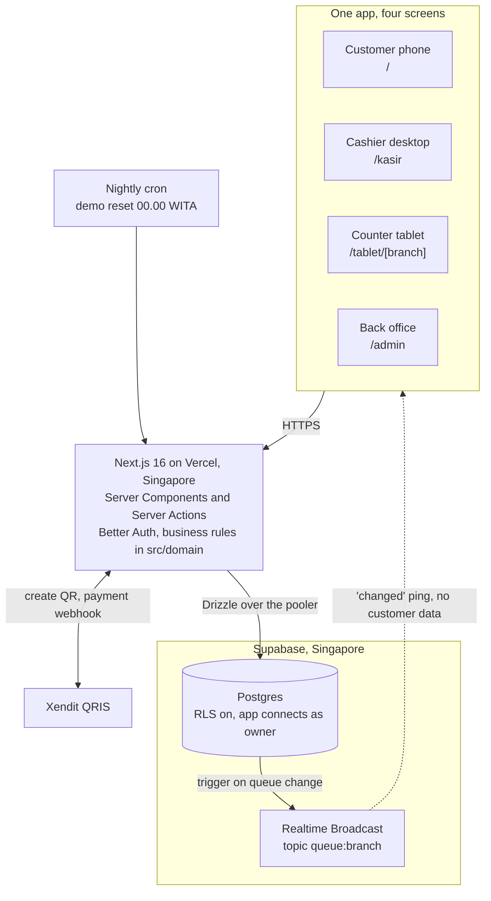

<h1 align="center">Consigliere</h1>

<p align="center">
  Take a number from your phone, pay by QRIS, walk in when it's your turn.<br>
  Queue, booking, membership and back office for a three-branch barbershop, in one Next.js app.
</p>

<p align="center">
  <a href="https://consigliere-barbershop.vercel.app"><strong>Live site</strong></a>
  &nbsp;&nbsp;|&nbsp;&nbsp;
  <a href="https://consigliere-barbershop.vercel.app/demo"><strong>Try every role at /demo</strong></a>
  &nbsp;&nbsp;|&nbsp;&nbsp;
  <a href="https://consigliere-barbershop.vercel.app/studi-kasus">Case study</a>
</p>

<p align="center">
  <a href="https://github.com/agamemnon-labs/consigliere-barbershop/actions/workflows/ci.yml"></a>
  
  
  
  
  
  
  
  
  
  
</p>



Consigliere is a portfolio piece by **Agamemnon**, built to the standard of software a real shop could run tomorrow. The brand is fictional; the pricelist, the queue rules and the membership scheme come from a working barbershop in Samarinda.

The problem it solves is small and very real: on a busy evening people wait an hour on a bench because the only way into the queue is to show up. Consigliere lets them see every barber's line from their phone, take a number, pay up front and arrive when they are next, while walk-ins keep doing exactly what they always did.

## What it does

**For customers (phone, no account needed)**

- Every service, price and barber in plain view, so nobody has to ask. Haircut price follows the barber's level.
- Live queue per branch and per barber, with the quietest branch marked.
- Booking in four short steps: branch, barber (or "whoever is fastest"), services, name and WhatsApp. Pay by QRIS and the number lands in the queue only once the money arrives, so there are no ghost bookings.
- A ticket that tells you your number, roughly when you're up and when to leave, updated live. After the cut, one tap rates the barber from 1 to 5.
- Membership card with a rotating QR, points, birthday-month discount and a prepaid balance you can top up from the phone.

**For the cashier (wide desktop)**

- One column per barber on duty. Call, seat, late, done: one tap each.
- Add a walk-in to any chair, charge at the chair, take EDC card or QRIS, apply member balance with the member's own PIN, print a 58 mm receipt.

**For the counter tablet**

- A big, read-only board: who's being called, who's next at each chair, and a QR to join the queue from your own phone. Shows ticket numbers only, never names.

**For the owner (back office)**

- Today across all branches, reports by branch, barber, service and payment method, barber commission and each barber's average rating, weekly barber rotation between branches, prices and levels, members, rules, and the WhatsApp outbox.

<table>
  <tr>
    <td width="50%"></td>
    <td width="50%"></td>
  </tr>
  <tr>
    <td align="center">Cashier board</td>
    <td align="center">Counter tablet</td>
  </tr>
  <tr>
    <td width="50%"></td>
    <td width="50%"></td>
  </tr>
  <tr>
    <td align="center">Back office, today</td>
    <td align="center">Back office, reports and commission</td>
  </tr>
</table>

## Rules that make it trustworthy

The interesting part of a queue system is the edge cases. These live in `src/domain/` as pure, unit-tested functions; the UI and server actions only call them.

- **Pay first, then queue.** A pending booking holds no place. The QRIS webhook settles it idempotently and checks amount and payment id. Money that arrives after the 15-minute window becomes credit instead of a surprise place in line.
- **Late is forgiven once.** Five minutes of grace after the call, then the customer moves back exactly one place. Absent at the second call is a no-show.
- **No cash refunds, no lost money.** Cancelling before the call turns into 30-day credit on the WhatsApp number, or into balance for members, which never expires.
- **Money is integer rupiah; points and balances are ledgers.** Nothing is a mutable number, so every rupiah has a row behind it and reports can split real cash from top-up bonus.
- **Commission is never rewritten.** A barber's level change applies from a chosen date and past commission stays as it was.
- **One clock.** Every "today" is computed in WITA (`Asia/Makassar`), whatever the server's timezone.

## Architecture



A few decisions behind it:

- **One codebase, role-based views.** Customer, cashier, tablet and owner are route groups in the same Next.js app, sharing one database and one set of rules. No separate admin system to keep in sync.
- **Realtime without leaking data.** A database trigger broadcasts only "branch X changed". Screens then refetch through the server, so no names or numbers ever travel over the public socket, and every table keeps RLS on with no public policies.
- **Swappable payments.** Xendit sits behind a `PaymentProvider` interface. Without keys, a demo provider issues a QR and a "simulate payment" button, so the whole flow is testable offline.
- **Zero-config local run.** With no `DATABASE_URL`, the app boots an in-memory Postgres (PGlite) with the real migrations and demo seed. The same trick runs the integration tests and the CI end-to-end suite.

## Performance

Lighthouse 12.8 against the live site, median of three runs (mobile uses Lighthouse's default throttled phone profile), measured 23 November 2026.

| Page                    | Performance | Accessibility | Best practices |                    SEO |
| ----------------------- | ----------: | ------------: | -------------: | ---------------------: |
| Home, mobile            |          99 |            95 |             96 |                    100 |
| Booking, mobile         |          99 |           100 |            100 |                    100 |
| Home, desktop           |         100 |            95 |             96 |                    100 |
| Counter tablet, desktop |          99 |           100 |            100 | not indexed on purpose |

Home on mobile: LCP about 2.1 s, CLS 0.001. The cashier and back office sit behind a login, so they aren't in the table.

## Stack

- **App:** Next.js 16.4 (App Router, Cache Components, React Compiler, typed routes), React 19.3, TypeScript 7 strict
- **UI:** Tailwind CSS 4.3 on the project's own tokens and components, two fonts with one job each (Alfa Slab One for the sign, Archivo for reading), no UI kit
- **Data:** Supabase Postgres and Realtime Broadcast, Drizzle ORM, Zod 4
- **Auth:** Better Auth, password for staff, phone and PIN for members, rate-limited in the database
- **Payments:** Xendit QRIS behind a swappable provider, EDC payments recorded by the cashier
- **Quality:** Vitest 5 with PGlite for real-Postgres tests, Playwright end-to-end, Biome, GitHub Actions CI
- **Hosting:** Vercel functions in Singapore next to the database, nightly cron for the demo
- **Monitoring:** Vercel Web Analytics (cookieless) and Speed Insights (Core Web Vitals from real phones), Sentry for server, browser and cron failures with no personal data attached

## Run it locally

Needs Node 26 and pnpm. No database or keys required.

```bash
pnpm install
pnpm dev
```

Open http://localhost:3000. `/demo` gives one-tap logins for member, cashier and owner, `/tablet/pulau-kalimantan` is the counter screen and `/gaya` is the live style sheet. Data lives in memory and resets on restart.

To run against your own Supabase project instead:

```bash
cp .env.example .env.local   # Supabase URLs, BETTER_AUTH_SECRET, SEED_STAFF_PASSWORD
pnpm db:migrate
pnpm db:seed
pnpm dev
```

Checks, all of which run in CI on every pull request:

```bash
pnpm check       # Biome lint and format
pnpm typecheck
pnpm test        # domain rules, migrations, seed and auth on PGlite
pnpm build
pnpm e2e         # Playwright, after a build
```

## Deploy

1. Create a Supabase project in Singapore and a login role for the app that owns the tables. Use the pooler with user `<role>.<project-ref>`: port 6543 for `DATABASE_URL`, 5432 for `DATABASE_URL_DIRECT`.
2. Import the repo into Vercel and add the variables from `.env.example`. For a public demo also set `DEMO_MODE=1`, `DEMO_STAFF_PASSWORD` (same as `SEED_STAFF_PASSWORD`) and `CRON_SECRET`. The build runs `pnpm build:deploy`, which migrates, seeds an empty database and then builds.
3. After the first migration, make `postgres` own `public.broadcast_queue_change()` so it may call `realtime.send`, and revoke `execute` on it from `public, anon, authenticated`.
4. Optional: add Xendit development keys (`XENDIT_SECRET_KEY`, `XENDIT_WEBHOOK_TOKEN`) and point the webhook at `<origin>/api/pembayaran/xendit`. Without them, payments stay in demo mode.
5. Turn on Web Analytics and Speed Insights in the Vercel project (the components are already in the root layout).
6. Optional: add the Sentry integration from the Vercel Marketplace and redeploy. It sets `NEXT_PUBLIC_SENTRY_DSN` (error reports on) and `SENTRY_AUTH_TOKEN`, `SENTRY_ORG`, `SENTRY_PROJECT` (readable stack traces). Without them the SDK never loads.

The cron in `vercel.json` resets the demo every night at 00.00 WITA.

## Docs

- [Brief](docs/brief.md): who it's for, the rules agreed with the shop, and a change log of every decision
- [Design doc](docs/design.md): stack, data model, domain rules, build phases and visual language
- [Design research](docs/design-research.md): sources and lessons behind the redesigns and the brand character

---

Built by **Agamemnon**.
